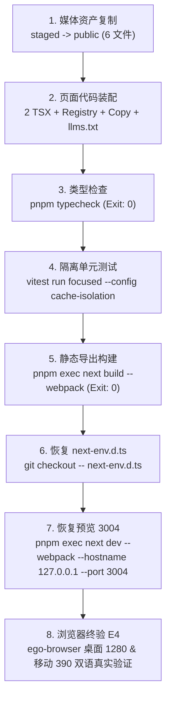

# 页面装配预检报告 (Project Assembly Preflight Report)

- **任务类型 (Role)**：只读页面装配预检叶子 (P2 Leaf Worker)
- **Task ID**：`task_4b726bc7982f`
- **Dispatch ID**：`ctx_265dc3fa50b8`
- **协调员终端 (Coordinator)**：`term_e23a001b-a645-4956-852b-d11d8689b9e4`
- **执行终端 (Worker)**：`term_8aa612fa-778f-4cbc-82f6-074532bda6c6`
- **工作树路径 (Workspace Root)**：`/Users/wusir/orca/workspaces/stardew planner/博客-2`
- **预检日期**：2026-10-13
- **基线核验结果**：**100% 匹配 (24/24 文件哈希一致，工作树自 P 备份后仍为完整旧版)**
- **预览服务 3004 状态**：`LISTEN`（PID `44772`，PGID `44758`，未漂移，严格只读探测）
- **交付结论**：接口、服务属主、媒体资产、路径边界与历史测试档案已核清，具备向未来 G 提供完整输入条件。

---

## 1. 角色边界与只读执行声明 (Scope & Non-Destructive Boundaries)

1. **单树与并发限制**：仅在唯一指定工作树 `/Users/wusir/orca/workspaces/stardew planner/博客-2` 执行。未创建任何工作树，无内置子代理、workflow 嵌套派发，严格遵守并发限制。
2. **纯预检叶子职责**：本任务为 P2 只读叶子，不兼任 A/B/C/D/E/F/T/G 角色。不读取新未审 writing 正文或研究资料进行内容创作，不替内容角色审稿，不实现业务代码，不修改任何现有规则。
3. **只写授权目录**：
   - 允许且仅写入：`docs/blog-ops/how-to-harvest-stardew-valley/rework-v2/project-preflight.md` 与 `docs/blog-ops/how-to-harvest-stardew-valley/rework-v2/project-preflight/` 内真实 raw stdout 文件。
   - **绝对未修改**：任何产品源码 (`src/`)、公开静态资产 (`public/`)、测试代码 (`tests/`)、依赖配置 (`package.json`, `pnpm-lock.yaml`)、运行时配置 (`next.config.ts`, `tsconfig.json`)、业务文件或服务监听状态。
   - 未在 `/tmp` 或 provider brain 创建任何文件。
4. **测试与构建执行限制**：node_modules 为共享软链，Turbopack 存在文件系统越界报错风险，且 `pnpm test` 会通过 pretest 触发全量 build。本任务严格不执行 `typecheck`、`vitest`、`build` 或 `dev`，仅只读解析脚本原型并记录真实可执行命令。
5. **不口头 PASS 原则**：所有对比、端口、进程均提供真实命令执行输出（已落盘至 `project-preflight/` 子目录），未经事实证据者仅标记为 `unverified`。

---

## 2. 基线留存状态与哈希比对 (Baseline Preservation & Hash Status)

对此前 P 角色留存的基线清单（`docs/blog-ops/how-to-harvest-stardew-valley/rework-v2/baseline/manifest.json`，共 24 个文件）逐一执行现场 SHA-256 重新计算与校验，对比结果如下：

### 2.1 源码与全局路由文件核验

| 文件路径 | 期望 SHA-256 (Baseline) | 现场计算 SHA-256 | 状态 |
| :--- | :--- | :--- | :---: |
| `src/blog/articles/how-to-harvest-stardew-valley.en.tsx` | `dacc4d0361dbd894eec29a6f67b554ce8ee5033d78de6aba1fa87b9b48218daf` | `dacc4d0361dbd894eec29a6f67b554ce8ee5033d78de6aba1fa87b9b48218daf` | **MATCH** |
| `src/blog/articles/how-to-harvest-stardew-valley.zh.tsx` | `98f2835aea750c56e931b933dd4b7ef158c679095c26fb0f5ea1f965827663ae` | `98f2835aea750c56e931b933dd4b7ef158c679095c26fb0f5ea1f965827663ae` | **MATCH** |
| `src/blog/blog-post-registry.tsx` | `ea146ecfe3e8553ee2355abf259bba7bb7982bad326ca5203faa28f09696fa2b` | `ea146ecfe3e8553ee2355abf259bba7bb7982bad326ca5203faa28f09696fa2b` | **MATCH** |
| `src/blog/blog-post-identities.ts` | `886b1f6081692fb7c4565b2e6c21ac2144c2aa372ba6fd95804ad4aa430cab3d` | `886b1f6081692fb7c4565b2e6c21ac2144c2aa372ba6fd95804ad4aa430cab3d` | **MATCH** |
| `src/blog/blog-copy.ts` | `bde4900d8c5cda4dabeb0021e0c76c84128e3138fbe0975aa1f739b14eaf8869` | `bde4900d8c5cda4dabeb0021e0c76c84128e3138fbe0975aa1f739b14eaf8869` | **MATCH** |
| `public/llms.txt` | `71c1d1f8185fbefacf7ba349bc628e0c735fd4e3bde4db1764eee418dc4c9341` | `71c1d1f8185fbefacf7ba349bc628e0c735fd4e3bde4db1764eee418dc4c9341` | **MATCH** |

### 2.2 现场 6 个公开旧图资产核验

| 文件路径 | 期望 SHA-256 (Baseline) | 现场计算 SHA-256 | 状态 |
| :--- | :--- | :--- | :---: |
| `public/blog/how-to-harvest-stardew-valley-cover.webp` | `8558f5b08e0c3e890ceddfcffb7104ed0a0fb0380dedec4108beed46220b81d8` | `8558f5b08e0c3e890ceddfcffb7104ed0a0fb0380dedec4108beed46220b81d8` | **MATCH** |
| `public/blog/how-to-harvest-stardew-valley-cover.avif` | `ccd28749dfd7047666d8bcbf8410aa929a060e660cc882d3814ef74d6dec19cd` | `ccd28749dfd7047666d8bcbf8410aa929a060e660cc882d3814ef74d6dec19cd` | **MATCH** |
| `public/blog/illustrations/how-to-harvest-stardew-valley-en-methods.webp` | `c5d987fdd4c2d1799358baf987ee31a5b7a9d90b5933c7e3fc1eb43c4a1883a5` | `c5d987fdd4c2d1799358baf987ee31a5b7a9d90b5933c7e3fc1eb43c4a1883a5` | **MATCH** |
| `public/blog/illustrations/how-to-harvest-stardew-valley-en-methods.avif` | `92476d4c389afbf12d2b40e1a0773139a33c6fd0e24df71be97918a05ba4d861` | `92476d4c389afbf12d2b40e1a0773139a33c6fd0e24df71be97918a05ba4d861` | **MATCH** |
| `public/blog/illustrations/how-to-harvest-stardew-valley-zh-methods.webp` | `450f78bb5aefcc6dda6826cb9fcda8a2af45f9778e077b49012596dbb38394f2` | `450f78bb5aefcc6dda6826cb9fcda8a2af45f9778e077b49012596dbb38394f2` | **MATCH** |
| `public/blog/illustrations/how-to-harvest-stardew-valley-zh-methods.avif` | `d918433c39793cf8f455281b4ba4606749eff17d68d7c6d682183f07f5e33d6a` | `d918433c39793cf8f455281b4ba4606749eff17d68d7c6d682183f07f5e33d6a` | **MATCH** |

### 2.3 其余 12 个历史运营与交接文档核验

- `docs/blog-ops/how-to-harvest-stardew-valley/handoffs/public-blog-handoff-en.json` (SHA: `8ed90b...` **MATCH**)
- `docs/blog-ops/how-to-harvest-stardew-valley/handoffs/public-blog-handoff-zh.json` (SHA: `3debdc...` **MATCH**)
- `docs/blog-ops/how-to-harvest-stardew-valley/writing/en-body.md` (SHA: `dd686b...` **MATCH**)
- `docs/blog-ops/how-to-harvest-stardew-valley/writing/locked/en-body.md` (SHA: `dd686b...` **MATCH**)
- `docs/blog-ops/how-to-harvest-stardew-valley/writing/en-media.json` (SHA: `1d4cd5...` **MATCH**)
- `docs/blog-ops/how-to-harvest-stardew-valley/writing/en-figure.svg` (SHA: `a6e017...` **MATCH**)
- `docs/blog-ops/how-to-harvest-stardew-valley/seo/en-seo.json` (SHA: `30ec27...` **MATCH**)
- `docs/blog-ops/how-to-harvest-stardew-valley/seo/en-public-references.json` (SHA: `2a1739...` **MATCH**)
- `docs/blog-ops/how-to-harvest-stardew-valley/translation/zh-body.md` (SHA: `ec8b60...` **MATCH**)
- `docs/blog-ops/how-to-harvest-stardew-valley/translation/zh-seo.json` (SHA: `44fda4...` **MATCH**)
- `docs/blog-ops/how-to-harvest-stardew-valley/translation/zh-media.json` (SHA: `7aae77...` **MATCH**)
- `docs/blog-ops/how-to-harvest-stardew-valley/translation/zh-figure.svg` (SHA: `50cd8f...` **MATCH**)

**核验结论**：
全量 24 个基线文件 100% 吻合（详见真实原始比对记录 `project-preflight/baseline-hash-check.txt`）。这证明**自 P 角色备份留存以来，当前工作树完全保持旧版状态，未发生任何脏写或未审覆盖**。

### 2.4 新媒体叶子 M 制作交付资产核验

叶子任务 M (`task_959d568156f3`) 交付的 6 个 Staged 文件位于 `docs/blog-ops/how-to-harvest-stardew-valley/rework-v2/media/staged/`，经现场核验：
- `how-to-harvest-stardew-valley-cover.webp` (1672×941, 479,250 B, SHA: `0f35cee83ceb6360e182f3b1e0522cb3f013f899872cb86be7b4cf47923ec574`)
- `how-to-harvest-stardew-valley-cover.avif` (1672×941, 237,604 B, SHA: `8c23cae6ef5b80dc03170718f206d90aa830839023f1ddf045b1c114779f9b57`)
- `how-to-harvest-stardew-valley-mature-crops.webp` (1672×941, 267,644 B, SHA: `d24578e3860ac37eaaa75f04bad130ec65a0f52b6015a8b3314dc9cbed9c51cd`)
- `how-to-harvest-stardew-valley-mature-crops.avif` (1672×941, 143,638 B, SHA: `cab14677146baef85fb6c9772da898a55cad9f67c54942e20966eac317a095c1`)
- `how-to-harvest-stardew-valley-trellis-paths.webp` (1672×941, 223,784 B, SHA: `027e085cd18da335a16ec9e8096796c086c9e40138b687fd3776c3f84e7d1ad4`)
- `how-to-harvest-stardew-valley-trellis-paths.avif` (1672×941, 113,557 B, SHA: `7991d66a038a9cc05c31927f64c295708651a5a6c019bb72095ec5b7ef09968a`)

全部文件通过 `sips` 尺寸核验（宽 1672、高 941），哈希与 `media.md` 100% 一致（原始记录见 `project-preflight/staged-media-check.txt`）。本任务确认其已就绪，保持只读，不修改、不提前复制进 `public/`。

---

## 3. 预览服务 3004 属主与进程组拓扑 (Preview 3004 Fresh Process Topography)

现场只读执行 `lsof` 与 `ps` 对端口 3004 进行了新鲜探测（原始输出见 `project-preflight/lsof-3004.txt` 与 `project-preflight/ps-3004.txt`）：

### 3.1 监听进程与拓扑关系

- **端口**：`127.0.0.1:3004` (LISTEN)
- **监听 PID**：`44772` (`next-server (v16.3.0)`)
- **真实 Owner PGID**：`44758`
- **父进程链路**：
  - `PID 79299` (`/usr/bin/login ... orca-tcc-login /bin/zsh -l`, TTY `ttys023`, root)
  - ↳ `PID 79325` (`-/bin/zsh -l`, TTY `ttys023`, wusir, PGID `79325`)
  - ↳ `PID 44758` (`node /opt/homebrew/opt/node@24/bin/pnpm exec next dev --webpack --hostname 127.0.0.1 --port 3004`, TTY `ttys023`, PGID `44758`, PPID `79325`)
  - ↳ `PID 44766` (`node .../next dev --webpack --hostname 127.0.0.1 --port 3004`, TTY `ttys023`, PGID `44758`, PPID `44758`)
  - ↳ `PID 44772` (`next-server (v16.3.0)`, TTY `ttys023`, PGID `44758`, PPID `44766`, LISTEN)
- **Orca 独立终端标识**：`term_7dfa2286-b04b-4b91-816a-73a4545cf236`（标题 `harvest-preview`）
- **CWD 工作目录**：`/Users/wusir/orca/workspaces/stardew planner/博客-2`（PID 44758、44772、79325 均在此工作树，FD `cwd` 节点完全一致）
- **漂移判定**：**未发生漂移**。PID 44772 仍为历史所记录的同一活跃进程，且持续维持稳定 LISTEN 状态。

### 3.2 邻近端口保护与严禁行为

现场探测邻近端口占用情况：
- `*:3003`：PID `23303`（main 工作树的 `next dev` 服务，严禁干扰）
- `[::1]:3002`：PID `84947`（AI image editor 项目 Vite 服务，严禁干扰）
- `[::1]:3005`：PID `71596`（其他工具服务，严禁干扰）
- `127.0.0.1:3013`：PID `97774`（`文案` 工作树的 `serve out` 服务，严禁干扰）

> [!CAUTION]
> **严禁执行 `pnpm dev` 或 `scripts/dev.sh`**：
> `package.json` 中的 `"dev": "sh scripts/dev.sh"` 脚本内写死了 `DEV_PORT=3003` 并强制先调用 `scripts/free-listen-port.sh 3003`。如果执行 `pnpm dev`（即使追加 `--port 3004`），该脚本会直接杀掉 3003 端口上的进程（PID 23303）！

### 3.3 未来 G 冲突协调与公开命令原型 (Lifecycle CLI Prototype)

若后续 G 在执行静态导出 `next build --webpack` 时与当前开发服务 `dev .next` 缓存发生冲突：
1. **停止服务**：仅协调停止属于本终端 3004 的进程组（**ONLY PGID 44758**），严禁全系统杀进程或误伤 3003。
2. **恢复预览**：构建完成后，在同一个独立终端 `term_7dfa2286-b04b-4b91-816a-73a4545cf236` 中执行标准原型命令恢复：
   ```bash
   pnpm exec next dev --webpack --hostname 127.0.0.1 --port 3004
   ```
   *(注：依协调员提醒，参数之间必须带真实空格，不复制无空格速写。本 P2 任务仅核对并记录原型，不执行任何启停操作。)*

---

## 4. 依赖环境与测试隔离边界 (Environment & Cache Isolation)

1. **共享符号链接**：
   - 本工作树下的 `node_modules` 为符号链接：`node_modules -> /Users/wusir/Desktop/开发项目集合/stardew planner/node_modules`。
   - **非操作系统隔离**：多工作树共享同一份 `node_modules`，不具备 OS 级别的环境与文件系统隔离。
2. **Next.js 16.3.0 Turbopack 限制**：
   - 官方 Next 16 源码规范中，Turbopack 遇到指向项目根目录外部的 `node_modules` 软链时，会报 `Symlink [project]/node_modules is invalid, it points out of the filesystem root` 错误而终止。
   - 因此，本项目构建必须显式指定 `--webpack` 标志。
3. **Vitest 私有缓存隔离配置**：
   - 默认 Vitest 会将缓存写入共享的 `node_modules/.vite`，造成跨工作树状态污染。
   - 本项目已具备私有缓存隔离配置 `docs/blog-ops/how-to-harvest-stardew-valley/verification/cache-isolation/vitest.config.mjs`，其通过 `cacheDir: ".next/verification-cache/vite"` 实现工作树内部缓存隔离。
   - 后续 G 执行 Vitest 时必须使用隔离命令：
     ```bash
     node_modules/.bin/vitest run <test-files> --config docs/blog-ops/how-to-harvest-stardew-valley/verification/cache-isolation/vitest.config.mjs --configLoader runner
     ```
   - **严禁直接在根目录执行 `pnpm test`**：`package.json` 中的 `pretest` 会先调用 `pnpm build`，进而触发 Turbopack 失败。

---

## 5. 站点真实装配接口规范 (Project Interface Specifications)

本篇关键词 `how to harvest stardew valley` 需完全复用站点既有路由、多语言与组件体系，无需发明任何新模板或设计：

### 5.1 身份标识与路由映射 (Identities & Routes)

- **Slug**：`how-to-harvest-stardew-valley`（在 `src/blog/blog-post-identities.ts` 的 `blogPostSlugs` 中排列为第 25 个）。
- **英文路由**：`/how-to-harvest-stardew-valley`（由 `app/(en)/[slug]/page.tsx` 动态段根据 `generateStaticParams` 自动生成）。
- **中文路由**：`/zh/how-to-harvest-stardew-valley`（由 `app/zh/[slug]/page.tsx` 动态段根据 `generateStaticParams` 自动生成）。
- **语言切换器**：`PublicPageShell` 与 `HomepageLocaleSwitcher` 内部调用公开函数 `getLocalizedPublicPath(locale, canonicalPath)`，无需另外设计语言切换逻辑。

### 5.2 核心公开函数与通信边界 (Public API Boundaries)

| 模块位置 | 公开导出符号 | 职责与入参边界 |
| :--- | :--- | :--- |
| `src/blog/blog-post-identities.ts` | `blogPostSlugs`, `isBlogPostSlug` | 25 个 slug 常量元组与类型谓词守护函数。 |
| `src/blog/blog-post-registry.tsx` | `getBlogPostBySlug(locale, slug)` | 根据语言和 slug 获取文章完整注册元数据与组件。 |
| `src/blog/blog-post-registry.tsx` | `getAllBlogPosts(locale)` | 获取指定语言全量文章数组（长度为 25）。 |
| `src/blog/blog-post-registry.tsx` | `validateBlogPostRegistry(posts)` | 强校验数组顺序、slug 对应、字段非空与 alt 长度。 |
| `src/blog/blog-copy.ts` | `getBlogCopy(locale)` | 获取文章阅读时长文案、侧边栏和归档文案。 |
| `src/blog/blog-copy.ts` | `getLocalizedBlogPostHref(locale, slug)` | 返回各语言实际路径（`Record<BlogPostSlug, string>`）。 |
| `src/i18n/public-route-registry.ts` | `getLocalizedPublicPath(locale, path)` | 将规范路径转为对应语言路径（中文带 `/zh` 前缀）。 |
| `src/seo/public-site-url.ts` | `createCanonicalUrl(pathname)` | 校验绝对路径（以 `/` 开头、无尾斜杠、无 hash/query）并拼接域名。 |
| `src/seo/page-metadata.ts` | `createPublicPageMetadata(input)` | 自动构造 canonical、hreflang（en, zh-CN, x-default）及 OG 元数据。 |
| `src/seo/page-structured-data.ts` | `createArticleStructuredData(input)` | 生成 Schema.org `Article` 结构化 JSON-LD 数据。 |

### 5.3 登记对象字段契约 (`BlogPostMeta`)

在 `src/blog/blog-post-registry.tsx` 中，`en` 与 `zh-CN` 数组各自需要包含如下精确字段：

```typescript
{
  slug: "how-to-harvest-stardew-valley",
  title: string,              // 英文与中文各经过审核的 H1 标题
  description: string,        // 纯文本描述，不带 HTML
  topic: string,              // 英文必须为 "Stardew Valley Guides"，中文必须为 "星露谷物语指南"
  author: string,             // 英文必须为 "Stardew Valley Planner Team"，中文必须为 "星露谷规划器团队"
  readTimeMinutes: number,    // 正整数，例如 7
  coverImage: {
    src: "/blog/how-to-harvest-stardew-valley-cover.webp", // 必须以 .webp 结尾
    alt: string,              // 至少 8 个字符的高保真画面描述
  },
  featured: false,            // 固定为 false
  Content: ComponentType,     // 对应导出的 Article 组件
}
```

### 5.4 媒体组件与图位绑定 (`PublicPicture`)

- **组件位置**：`src/components/public-picture.tsx`
- **入参约束**：
  - `src`：**必须且只能以 `.webp` 结尾**，且不能包含空文件名。
  - 函数 `createPublicAvifSource(src)` 会自动切除 `.webp` 后缀并拼装成同名 `.avif` 资源写入 `<source srcSet="..." type="image/avif" />`。若传入非 `.webp` 路径会立即抛出 `TypeError` (FailFast 原则)。
  - `alt`：必须为有实际意义的描述字符串。
- **文章图位尺寸规范**：
  - 封面图：`width={1672}`, `height={941}`，外壳自动包覆在 `BlogArticleContent` 中，首屏渲染，不带 `loading="lazy"`。
  - 正文图：`<figure className="blog-article-media">` 包裹 `<PublicPicture width={1672} height={941} loading="lazy" decoding="async" src="..." />`，下方为 `<figcaption>`。
- **本篇 3 处图位资产映射**：
  1. 封面图：`public/blog/how-to-harvest-stardew-valley-cover.webp` (及配套 `.avif`)
  2. 正文图 1（成熟作物近景）：`public/blog/illustrations/how-to-harvest-stardew-valley-mature-crops.webp` (及配套 `.avif`)
  3. 正文图 2（棚架通道走道）：`public/blog/illustrations/how-to-harvest-stardew-valley-trellis-paths.webp` (及配套 `.avif`)
  *(由于画面均已裁除所有文字与 HUD，中英文双语文章完全共用此 3 张画面，无需制作语言后缀图)*

### 5.5 `public/llms.txt` 清单格式

- 英文段落（`## English` -> `### Planning guides`）：
  `- [英文文章标题](https://stardewvalleyplanner.art/how-to-harvest-stardew-valley): 英文描述正文`
- 中文段落（`## 简体中文` -> `### 农场规划指南`）：
  `- [中文文章标题](https://stardewvalleyplanner.art/zh/how-to-harvest-stardew-valley): 中文描述正文`

---

## 6. 历史测试档案与真实基线定性 (Historical Test Baseline & Records)

根据此前留存的验证档案（`docs/blog-ops/how-to-harvest-stardew-valley/verification/assembly.md`），必须严格区分**历史真实记录**与**未来 G 新验证**，严禁口头宣称“全量已通过”：

### 6.1 单元测试全量运行历史记录 (`vitest-unit-without-export.log`)

- **历史结果**：**11 项失败 / 241 项通过**（测试文件总计 252 个，用例 11 失败 / 2421 通过）。
- **本篇直接相关并已局部修复通过的 2 项测试**：
  1. `tests/blog/blog-components.test.tsx`：文章数达到 25 篇后专题页分为 3 页（第 2 页 Next 指向第 3 页，第 3 页 Next 禁用）。
  2. `tests/blog/blog-planner-cta.test.tsx`：收获文正文独立处理，不包含 Sources 列表且无规划器 CTA 注入。
  *(注：这两项在 8 个关键文件、92 项用例的局部聚焦套件 `vitest-contract-and-focused-r2.log` 中已达到 92 PASS 0 FAIL)*。
- **既有全局基线失败（非本篇造成、严禁越界修改的 5 项）**：
  1. `tests/assets/public-avif-assets.test.ts`：硬编码期望 81，全站实际已超过 100。
  2. `tests/blog/blog-article-content.test.tsx`：松树中文正文历史缺失片段。
  3. `tests/blog/pine-tree-stardew-identity.test.ts`：同上松树断言。
  4. `tests/blog/blog-sources.test.tsx`：松树英文来源句子历史差异。
  5. `tests/routes/llms.test.ts`：历史缺失 `stardew-fruit` 链接。
- **未建立对照基线的 4 项失败（保持真实记录，不擅自修改）**：
  - `tests/catalog/catalog-loader.test.ts`
  - `tests/components/editor-modal.test.tsx`
  - `tests/components/editor-shell.test.tsx`
  - `tests/resources/local-planner-resource-smoke.test.ts`

### 6.2 导出测试历史记录 (`vitest-export.log`)

- **历史结果**：**1 文件失败 / 2 文件通过**（3 失败 / 9 通过）。
- **通过项**：`tests/routes/sitemap-robots.test.ts`、`tests/routes/removed-public-pages.test.ts`（计数更新为 31 / 62 / 60 / 60）。
- **失败项**：`tests/routes/static-public-pages.test.ts`（3 处历史失败：`/blog` 找 `how-to-earn-money` 封面缺失、首页区块顺序、404 页 CSS 路径 Webpack 命名差异）。

### 6.3 构建历史记录

- `pnpm build` (Turbopack)：**EXIT 1**（软链越界，预期失败）。
- `pnpm build --webpack`：**EXIT 0**（66/66 静态页面成功导出）。
- 注意：构建会瞬时将 `next-env.d.ts` 的 import 路径由 `.next/dev/types/` 改为 `.next/types/`，未来构建后需通过 `git checkout -- next-env.d.ts` 恢复。

---

## 7. 未来角色 G 允许写入文件清单与防漂移红线 (Allowed Scope for Worker G)

为确保高内聚低耦合与严格防漂移，未来 G 角色执行装配时，允许修改的文件范围被严格限制在以下闭合清单内：

### 7.1 允许写入的生产与资产文件 (Production Files)

1. `src/blog/articles/how-to-harvest-stardew-valley.en.tsx`（装配审核后的英文正文与 2 处正文图组件）
2. `src/blog/articles/how-to-harvest-stardew-valley.zh.tsx`（装配审核后的中文译文与 2 处正文图组件）
3. `src/blog/blog-post-identities.ts`（核验 `blogPostSlugs` 末尾第 25 个 slug）
4. `src/blog/blog-post-registry.tsx`（更新 en 与 zh-CN 登记对象：title, description, readTime, coverImage.alt）
5. `src/blog/blog-copy.ts`（核验 `localizedBlogPostPaths` 中英映射）
6. `public/llms.txt`（更新中英条目的 title 与 description）
7. `public/blog/how-to-harvest-stardew-valley-cover.webp` 与 `.avif`（从 `media/staged/` 复制）
8. `public/blog/illustrations/how-to-harvest-stardew-valley-mature-crops.webp` 与 `.avif`（从 `media/staged/` 复制）
9. `public/blog/illustrations/how-to-harvest-stardew-valley-trellis-paths.webp` 与 `.avif`（从 `media/staged/` 复制）

### 7.2 允许修改的本篇直接受影响测试文件 (Directly Affected Tests)

1. `tests/blog/blog-post-registry.test.ts`（断言 25 个 slugs 列表）
2. `tests/blog/blog-home-state.test.ts`（断言 25 篇文章、3 个专题页）
3. `tests/routes/blog-routes.test.tsx`（调整首页轮播首屏断言）
4. `tests/i18n/public-route-registry.test.ts`（断言 31 / 62 / 60 路径计数）
5. `tests/seo/canonical-public-routes.test.ts`（断言 31 canonical 计数）
6. `tests/routes/removed-public-pages.test.ts`（断言 31 / 62 / 60 及 sitemap 60 loc）
7. `tests/blog/blog-components.test.tsx`（分页第 2 页与第 3 页前后翻页链接）
8. `tests/blog/blog-planner-cta.test.tsx`（收获文 Sources/CTA 独立逻辑分支）
9. `docs/blog-ops/how-to-harvest-stardew-valley/verification/assembly/render-reader-text.test.tsx`（正文保真文本比对测试）

### 7.3 绝对禁止的漂移行为 (Forbidden Actions)

- **严禁修改全局 UI 与外壳**：不改 `PublicPageShell`、导航栏、页脚、弹窗、Canvas 等组件。
- **严禁为未来设计抽象**：不新增 TypeScript 接口层、工厂模式或额外的类。
- **严禁修复无关历史测试**：不改动 `public-avif-assets`（81 个断言）、`static-public-pages`（404 css / home 顺序）、`catalog-loader` 等无关测试。
- **严禁创建临时页面**：不创建任何临时 HTML、Demo 站点或独立展示页。
- **严禁危险操作**：不执行 `git commit`、`git push`、`git merge`、`deploy`、修改依赖或外部服务写入。

---

## 8. 未来 G 角色短验证清单 (Short Verification Checklist for G)

未来 G 角色就位后，按以下步骤执行精确验证与闭环：



1. **Step 1: 资产安装**
   - 将 `docs/blog-ops/.../rework-v2/media/staged/` 下 6 个 WebP/AVIF 文件复制到 `public/` 对应位置。
   - 核对 `shasum -a 256` 100% 匹配。
2. **Step 2: 源码装配**
   - 将已锁定的中英文正文与 2 个图位组件写入 2 份 TSX。
   - 更新 `src/blog/blog-post-registry.tsx` 的 title、description、coverImage.alt。
   - 更新 `public/llms.txt`。
3. **Step 3: 类型检查**
   - 运行 `pnpm typecheck`，确保退出码为 0。
4. **Step 4: 隔离单元测试**
   - 运行带缓存隔离配置的 Vitest：
     `node_modules/.bin/vitest run tests/blog/blog-post-registry.test.ts tests/blog/blog-home-state.test.ts tests/routes/blog-routes.test.tsx tests/i18n/public-route-registry.test.ts tests/seo/canonical-public-routes.test.ts tests/blog/blog-components.test.tsx tests/blog/blog-planner-cta.test.tsx --config docs/blog-ops/how-to-harvest-stardew-valley/verification/cache-isolation/vitest.config.mjs --configLoader runner`
   - 确保聚焦套件全部通过。
5. **Step 5: Webpack 静态构建**
   - 若 dev 服务冲突，协调停止 PGID 44758。
   - 运行 `pnpm exec next build --webpack`。
   - 确认生成 66 个静态页面，包括 `out/how-to-harvest-stardew-valley.html` 与 `out/zh/how-to-harvest-stardew-valley.html`。
   - 执行 `git checkout -- next-env.d.ts` 恢复类型引用。
6. **Step 6: 重启开发服务**
   - 在独立终端 `term_7dfa2286-b04b-4b91-816a-73a4545cf236` 恢复：
     `pnpm exec next dev --webpack --hostname 127.0.0.1 --port 3004`
7. **Step 7: 交付 E4 浏览器原生视图验收**
   - 使用本地 `ego-browser` 访问：
     - `http://127.0.0.1:3004/how-to-harvest-stardew-valley`
     - `http://127.0.0.1:3004/zh/how-to-harvest-stardew-valley`
   - 验证桌面 (1280×800) 与手机 (390×844) 下的图文渲染、无横向溢出、语言切换点击和 DOM 节点完整性。
